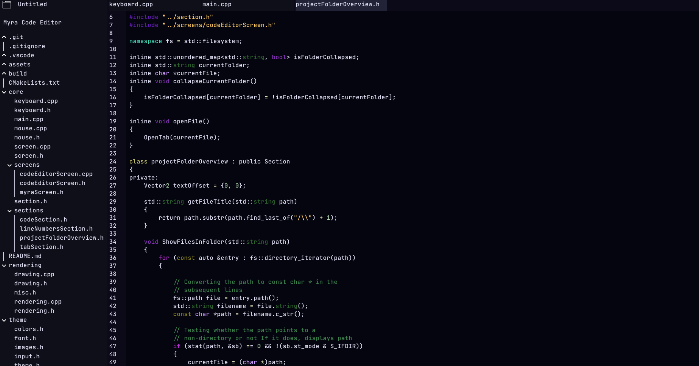

# Myra — a performant, highly customizable, and unique code editor.

## Myra is still in development!

It's not recommended as a daily driver just yet, but if you'd like to help improve this little project, feel free to try it out and contribute!

# Keybinds:

**CTRL+O** - Open a file  
**CTRL+SHIFT+O** - Open a file  
**CTRL+S** - Save a file  
**CTRL+V** - Paste text  
**CTRL+C** - Copy selected text  
**CTRL+V** - Paste text  
**CTRL+X** - Cut selected text  
**CTRL+A** - Select all text  
**CTRL+ALT+RIGHT** - Switch to next tab  
**CTRL+ALT+LEFT** - Switch to previous tab  
**CTRL+N** - Create new file/tab  
**CTRL+Q** - Close current tab
**CTRL+Z** - Undo
**CTRL+Y** - Redo

# Building Myra from source:

To build Myra, you'll need CMake and ninja/make installed.
Also, SDL3, SDL3_image, and SDL3_ttf need to be installed on your system (for ease of use, you should probably use a package manager)

# Third party libraries used

- [tinyfiledialogs](https://sourceforge.net/projects/tinyfiledialogs/): for cross-platform native dialogs (file open/save)
- [SDL](https://www.libsdl.org/): the rendering backend Myra uses
- [SDL_ttf](https://github.com/libsdl-org/SDL_ttf): font loading and text rendering
- [SDL_image](https://github.com/libsdl-org/SDL_image): rendering image files

# Credits

<a target="_blank" href="https://icons8.com/icon/843/folder">Folder</a> icon by <a target="_blank" href="https://icons8.com">Icons8</a>

<a target="_blank" href="https://icons8.com/icon/85123/drop-down-arrow">Drop Down Arrow</a> icon by <a target="_blank" href="https://icons8.com">Icons8</a>

<a target="_blank" href="https://icons8.com/icon/86214/collapse-arrow">Collapse Arrow</a> icon by <a target="_blank" href="https://icons8.com">Icons8</a>
